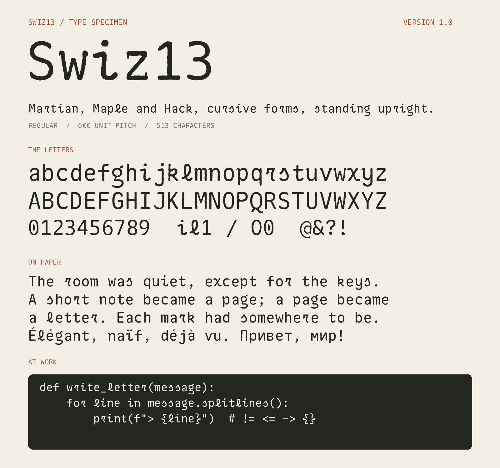

# Swiz13

A monospaced, typewriter-flavoured font with **cursive letterforms that stand upright**.

Swiz13 is a glyph-by-glyph blend of **Maple Mono Italic, Hack Italic and Martian Mono**, straightened so
nothing leans, and finished with a typewriter touch: ink-spread corners, an uneven strike and tiny per-letter
offsets. A handful of letters are hand-picked rather than blended:

| Characters | Where they come from |
|---|---|
| `( ) [ ] { }` | Google Sans Code |
| `Q` | Google Sans Code |
| `+ < = > \| ~ ¬ ± × ÷ ⁄ − ← → ↑ ↓` (maths symbols and arrows) | Google Sans Code |
| letters with a tilde (`ã ñ õ ũ ẽ ỹ ĩ` and capitals), `˜`, combining tilde | this font's own base letter plus Google Sans Code's tilde, copied exactly (position over the base letter adapted) |
| `~` | Google Sans Code, copied exactly as drawn (curves included, only scaled to 1000 units): no wobble, no ink spread, no thinning |
| special characters: punctuation, currency and other symbols (`! # $ % & * , - . / : ; ? \ ^ _ \` ¡ ¢ £ ¥ § © « ® » ¿ – — “ ” … € ™` and the like; not the straight quotes) | Google Sans Code |
| `s` (lowercase only) | drawn after the user's picture: a flat top, a short arm curling out to the left and a long stroke wrapping round the bottom, one uniform weight (`S_STROKE`) |
| `m n p u y` (left), `v w` (both sides) | a tiny leading tail added at the top of the outer stems (`FLAG_*` in `scripts/build.py`; `w` is narrowed 8% to make room) |
| `z` | a small downward leading tail at the left end of the top bar and a small upward ending tail at the right end of the bottom bar (`Z_TAIL`); the letters are centred by their body, not the tail |
| `r` | drawn after the ligatured Sligoil `r` in `sources/r-reference.png`, as one uniform-weight stroke (`R_STROKE`), a little wider at the top (`R_TOP_WIDEN`) |
| `l` | the blended `l`, straightened (extra de-slant, same design) |
| `g` | Google Sans Code, with the left wall of its bottom loop removed (an open, hooked tail) |
| `0` | Hack |
| `a` (and its accented forms) | an upright drawing of the same style, bundled in `sources/` |
| `f` | the blended `f` with its small tail cut off |
| `o` (lowercase only) | Martian Mono's `o`, unchanged |
| `"` and `'` | drawn: perfectly vertical, heavy straight bars |

* 513 characters: Latin (with accents), Cyrillic, digits, punctuation, symbols
* 1000 units per em, fixed 600-unit advance, upright, one Regular style, family name **`Swiz13`**
* Outputs: `fonts/Swiz13-Regular.ttf` and `fonts/Swiz13-Regular.woff2` (already built in this zip)



---

## Quick start (Linux)

```bash
unzip Swiz13-v1.0.zip && cd Swiz13

./build.sh          # builds the font in a few seconds (creates .venv, installs Python deps)
./install.sh        # installs it for your user and refreshes the font cache
```

Then pick the font family **`Swiz13`** in your editor or terminal (see [Using the font](#using-the-font)).
The zip already contains the finished `fonts/Swiz13-Regular.ttf`, so if you only want to install,
`./install.sh` alone is enough.

`make` shortcuts: `make build`, `make install`, `make install-system`, `make full`, `make uninstall`, `make test`.

### Prerequisites

| Distro | Packages |
|---|---|
| Debian / Ubuntu / Mint | `sudo apt install python3 python3-venv fontconfig` |
| Fedora / RHEL | `sudo dnf install python3 fontconfig` |
| Arch / Manjaro | `sudo pacman -S python fontconfig` |
| openSUSE | `sudo zypper install python3 fontconfig` |

You need Python 3.10 or newer (tested on 3.13), internet access for `pip` on the first build, and about
1 GB of RAM. No fonts need to be downloaded: the donor fonts are bundled in `sources/`.

---

## Building

| Command | What it does |
|---|---|
| `./build.sh` | **Fast build (seconds).** Reuses the shipped glyph blend (`build/blend-raw.pkl`), applies the hand-picked glyphs and the typewriter finish, writes the `.ttf` and `.woff2`, runs the tests. |
| `./build.sh --full` | **Complete rebuild from the donor fonts.** Recomputes the blend from scratch (10-15 minutes; uses all CPU cores). The result is identical to the shipped font. |
| `SPECIMENS=1 ./build.sh` | Also renders the specimen and comparison sheets into `specimens/`. |

The build is deterministic: the same inputs always give the same font. Outputs:

* `fonts/Swiz13-Regular.ttf`, `fonts/Swiz13-Regular.woff2`
* `sources/glyph-blend.json`: which donor(s) each character was made from

Without the helper script, the same thing by hand:

```bash
python3 -m venv .venv && source .venv/bin/activate
pip install -r requirements.txt
python scripts/make.py --skip-blend     # or: python scripts/make.py   (full rebuild)
python -m unittest discover -s tests
```

---

## Installing

| Command | Effect |
|---|---|
| `./install.sh` | Installs for the current user into `~/.local/share/fonts/Swiz13/` and runs `fc-cache`. No root needed. |
| `sudo ./install.sh --system` | Installs for all users into `/usr/local/share/fonts/Swiz13/`. |
| `./install.sh --monospace` | Additionally installs a fontconfig alias so applications asking for the generic `monospace` font get Swiz13. |
| `./install.sh --uninstall` | Removes it (add `--system` for the system-wide copy). |

Manual install, if you prefer:

```bash
mkdir -p ~/.local/share/fonts/Swiz13
cp fonts/Swiz13-Regular.ttf ~/.local/share/fonts/Swiz13/
fc-cache -f
```

**Verify:**

```bash
fc-list | grep -i swiz13          # should print the path and "Swiz13:style=Regular"
fc-match "Swiz13"                 # should answer Swiz13-Regular.ttf: "Swiz13" "Regular"
```

Applications read the font list at start-up, so **restart** your editor or terminal (or log out and in) after
installing.

---

## Using the font

| Where | How |
|---|---|
| **VS Code** | `settings.json`: `"editor.fontFamily": "Swiz13, monospace"`; terminal: `"terminal.integrated.fontFamily": "Swiz13"` |
| **JetBrains IDEs** | Settings > Editor > Font > Font: `Swiz13` (and Console Font) |
| **GNOME Terminal / Console** | Preferences > Profile > Custom font > `Swiz13 Regular` |
| **KDE Konsole / Kate** | Settings > Edit Profile > Appearance > Font (choose `Swiz13`) |
| **Alacritty** (`alacritty.toml`) | `[font.normal]` `family = "Swiz13"` |
| **Kitty** (`kitty.conf`) | `font_family Swiz13` |
| **WezTerm** (`wezterm.lua`) | `config.font = wezterm.font("Swiz13")` |
| **foot** (`foot.ini`) | `font=Swiz13:size=12` |
| **tmux / vim in a terminal** | The terminal's font setting decides; set it there. |
| **GTK desktop** | GNOME Tweaks > Fonts > Monospace Text > `Swiz13` (or `./install.sh --monospace`) |
| **Web page** | `@font-face { font-family: "Swiz13"; src: url("Swiz13-Regular.woff2") format("woff2"); }` |

The font has no bold or italic: if an application synthesises them, the result is the application's doing.

### Troubleshooting

* **Font not listed:** run `fc-cache -fv | grep -i swiz13`, check the file is readable (`ls -l ~/.local/share/fonts/Swiz13`), then restart the app. Flatpak/Snap apps may not see `~/.local/share/fonts`; for Flatpak run `flatpak override --user --filesystem=xdg-data/fonts:ro` (or install system-wide).
* **An old copy keeps showing:** `./install.sh --uninstall`, `fc-cache -f`, restart the app, then install again.
* **`python3 -m venv` fails on Debian/Ubuntu:** `sudo apt install python3-venv`.
* **`pip` cannot build a package:** use Python 3.10-3.13 and update pip (`python -m pip install -U pip`); all dependencies publish binary wheels for Linux x86-64 and arm64.
* **Out of memory in `--full`:** close other programs, or use the fast build, which does not need the blend step.
* **Terminal letters look misaligned:** the font is strictly monospaced (600/1000 em); make sure the terminal uses it for all text and has no "fallback to proportional" setting.

---

## How it is made

1. `scripts/donors.py` loads each donor font, scales it into one cell (1000 upm, 600 pitch, x-height about 550, cap height about 730) and rasterises the glyphs into signed distance fields. Martian Mono has no italic, so it is slanted (`SLANT`) to sit with the other two.
2. `scripts/blend.py` **blends**: per glyph it matches stroke weight (`TARGET`), registers the donors to each other with optical flow, averages them with role weights (`weights_for`; lowercase leans on Maple Mono Italic's cursive forms), drops a donor that disagrees too much (`EXCLUDE`, IoU gate), then smooths and traces the outline into `build/blend.pkl`.
(Every letter is centred in its 600-unit cell by `scripts/build.py`; accented letters take their base letter's shift.)

3. `scripts/overrides.py` applies the hand-picked glyphs listed at the top: the brackets, `Q` and `g` (Google Sans Code), `0` (Hack), the tail-less `f`, the `o` (Martian Mono's) and the drawn straight quotes. It always starts from `build/blend-raw.pkl`, the untouched blend, so it can be re-run safely.
4. `scripts/build.py` applies the **typewriter finish**, shears the italic slant back out (`DESLANT`, skipped for the upright overrides), copies the lowercase `a` and its accented forms from the upright reference font (`sources/UprightReference-Regular.ttf`), and assembles the TrueType font, metrics, names, OS/2 coverage flags and the WOFF2.
5. `scripts/specimen.py` and `scripts/compare.py` render the specimen and seven comparison sheets (Swiz13 against the upright Martian Mono, Maple Mono, Hack and Google Sans Code, at the same width) plus one combined PDF, `specimens/Swiz13-Comparison-All.pdf`. Run `SPECIMENS=1 ./build.sh` to regenerate them.

### Tuning knobs

| File | Setting | Effect |
|---|---|---|
| `scripts/blend.py` | `TARGET` (86) | stem width of the blend (higher = bolder) |
| | `weights_for()`, `EXCLUDE`, IoU gate `< 0.60` | which donors contribute and when one is dropped (needs `./build.sh --full`) |
| `scripts/donors.py` | `SLANT` | slant given to Martian Mono; `build.py` removes the same amount |
| `scripts/build.py` | `INK`, `WOBBLE`, `STRIKE`, `TILT` | typewriter finish; set `WOBBLE`, `STRIKE`, `TILT` to 0 for a clean version |
| | `DESLANT = False` | gives back the slanted italic version |
| | `VERSION`, names in `main()` | font metadata |
| `scripts/overrides.py` | `OVERRIDES` | which characters come from which font (tags ending in `-upright` are not de-slanted) |
| | `G_CUT`, `F_CUT` | the opening in the `g`'s bottom loop; where the `f`'s tail is cut |
| | `L_STRAIGHTEN` | the `l`'s extra de-slant |
| | `QUOTE_TOP`, `QUOTE_BOTTOM`, `QUOTE_RADIUS` | length and weight of the straight quotes |

Changes to `build.py` or `overrides.py` only need `./build.sh`; changes to `blend.py` or `donors.py` need `./build.sh --full`.

---

## Project layout

```
build.sh  install.sh  Makefile     build / install helpers (Linux)
fonts/        Swiz13-Regular.ttf, .woff2   (built)
scripts/      the build pipeline (make.py runs it all) + fetch_sources.py
sources/      donor fonts, the upright reference font, r-reference.png,
              sources/README.md (origins) and glyph-blend.json
build/        blend-raw.pkl (the cached glyph blend, lets ./build.sh finish in seconds)
              and blend.pkl (blend plus hand-picked glyphs, written by the build)
contrib/      optional fontconfig alias used by install.sh --monospace
licenses/     OFL.txt, HACK-LICENSE.md
specimens/    specimen and comparison sheets
tests/        test_font.py
```

## Licensing

Swiz13 is released under the **SIL Open Font License 1.1** (`licenses/OFL.txt`). It is derived from
Martian Mono, Maple Mono and Google Sans Code (OFL 1.1) and Hack (MIT and Bitstream Vera license,
`licenses/HACK-LICENSE.md`); the names "Bitstream" and "Vera" are not used. `install.sh` copies the license
files next to the installed font; keep them when redistributing.
